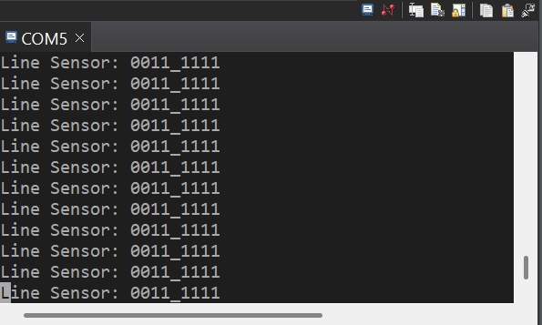

# ECE 528/L - Robotics and Embedded Systems with Lab
**CSU Northridge**

**Department of Electrical and Computer Engineering**

## Line Follower Lab

### Overview
In this lab, the robot follows a black line using the 8-channel reflectance sensor array and the DC motors. The sensors are read every 10 ms from the Timer A1 periodic interrupt. Each reading is an 8-bit value where `1` means black (line) and `0` means white.

The first version matched exact sensor patterns in a `switch` statement and used fixed delays for turns. The final version uses:

* **PD steering:** The line position from `Reflectance_Sensor_Position()` (about -334 to +334, in 0.1 mm units) is used as the error. The motor speeds are adjusted by `KP * error + KD * (error - prev_error)`, and the robot slows down on sharp curves.
* **State machine:** The robot has the states `FOLLOW`, `CLEAR_INTERSECTION`, `TURN_LEFT`, `TURN_RIGHT`, `SEARCH` and `STOPPED`, so turns and line searches don't block the program with delays.
* **Short interrupt:** The Timer A1 interrupt only reads the sensors and sets a flag. The control code and UART printing run in the main loop.

### Components Used
* TI MSP432P401R LaunchPad (user LEDs, Timer A0 PWM, Timer A1, SysTick, EUSCI_A0 UART)
* Pololu Gearmotor with Encoder - [Product Link](https://www.pololu.com/product/3675)
* 8-Channel QTRX Sensor Array - [Product Link](https://www.pololu.com/product/3672)
* Robot chassis with motor driver and power distribution board
* Black line track

### Analysis and Results
The sensor data is printed over UART at 115200 baud with `Print_Binary()`. Some example readings and how the robot responds to them:

| Sensor Reading | Meaning | Robot Response |
|---|---|---|
| `0001_1000` | Line centered | Drive straight (green LED) |
| `0000_1100` | Line slightly to the right | PD steers right |
| `0011_0000` | Line slightly to the left | PD steers left |
| `1111_1000` | Left turn | Clear the intersection, then spin left until the center sensors find the line (white LED) |
| `0001_1111` | Right turn | Clear the intersection, then spin right until the center sensors find the line (sky blue LED) |
| `1111_1111` | T-intersection | Turn right |
| `0000_0000` | Line lost | Spin toward the side where the line was last seen (yellow LED). Stop after 3 s (red LED) |

Bit 0 (P7.0) is the rightmost sensor and bit 7 (P7.7) is the leftmost.

Starting gains and constants: `KP = 5`, `KD = 10`, `PWM_NOMINAL = 2500`, `MAX_PWM = 5000`, `TURN_SPEED = 2000`.

Compared to the first version, PD control handles every sensor pattern, not just a few exact ones. This made the line following smoother and reduced zig-zagging. Because turns end when the line is found again instead of after a fixed delay, they no longer depend on battery level or floor friction.

Serial Terminal from `PrintBinary`:

### Known Issues or Limitations
* The robot seems to still struggle on the track I created, likely due to the table not reflecting the light correctly. When using the terminal, the readings from the sensors seemed to fire at random occasionally causing the robot to execute incorrect instructions and get off track. Adding paper under the tape slightly helped but still faced the same issues.
* The robot once spun in circles nonstop. When all sensors read black (for example, when the robot was lifted off the track), the intersection, turn and stop states kept triggering each other in a loop. This was fixed so the robot only resumes when it sees a normal line pattern.
* At first the robot struggled on left turns because several decisions defaulted to turning right. This was improved by keeping track of the last side the line was seen on and counting left and right sensor hits during intersection detection.
* T-intersections always turn right.
* The gains and speeds were tuned by trial and error and may need retuning for a different track or battery level.
* The sensor read time is fixed at about 1 ms, so readings may be wrong on very dark or very shiny surfaces.

### References
* [Pololu QTRX-MD-08A Reflectance Sensor Array](https://www.pololu.com/product/3672)
* [Instructables Advanced Line Following Robot](https://www.instructables.com/Advanced-Line-Following-Robot/)
* [Pololu Gearmotor with Encoder](https://www.pololu.com/product/3675)
* [TI MSP432P401R Datasheet](https://www.ti.com/product/MSP432P401R)
* [TI MSP432P4xx Technical Reference Manual (SLAU356)](https://www.ti.com/lit/ug/slau356i/slau356i.pdf)
* Wang, Lei, "Advanced Line-Follower Robot" (2017). ETD Archive. 1027.
https://engagedscholarship.csuohio.edu/etdarchive/1027
* [Microbot Advanced Line Follower](https://robottini.altervista.org/)
* ECE 528L lab manual and provided driver code (Aaron Nanas)
